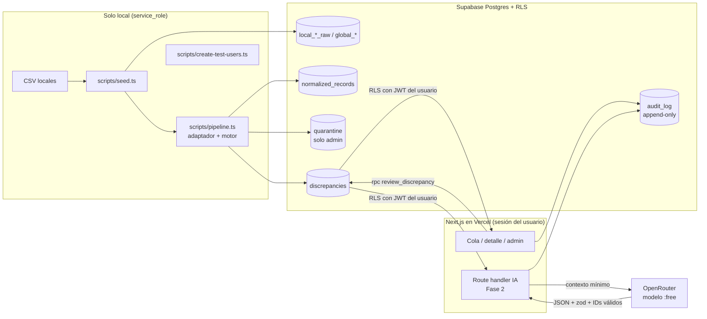

# Diseño

## 0. Sistema de diseño

| Elemento | Decisión |
|---|---|
| **Paleta** | Fondo "Libro mayor" `#F2F4F3` · Superficie `#FFFFFF` · Texto "Tinta" `#14212B` · Texto secundario `#4A5A63` · Borde `#CDD5D3` · Acento "Azul cierre" `#1D5AA6` (acciones, foco, enlaces) · Alerta "Varianza" `#A8321C` (solo valores fuera de umbral) |
| **Tipografía** | Títulos: **Archivo** semicondensada y gruesa. Cuerpo: **IBM Plex Sans** con números tabulares, para que los montos queden alineados |
| **Escala tipográfica** | 14 / 16 / 20 / 28 / 40 px (`text-sm` … `text-2xl`). Espaciado en múltiplos de 4 |
| **Layout** | Cola densa tipo libro contable en tabla desde 768 px; filas apiladas en móvil |
| **Elemento firma** | La **regla de varianza**: una barra corta centrada en el valor global, con la banda del umbral sombreada y la diferencia local en rojo cuando sale de la banda. Es el único momento animado y respeta `prefers-reduced-motion` |

Definido en `app/globals.css` (`@theme`). No se usan librerías de componentes. Los íconos vienen de `lucide-react`.

## 1. Arquitectura



## 2. Modelo de datos

| Grupo | Tablas | Migración |
|---|---|---|
| Geografía y perfiles | `regions`, `countries`, `profiles` | 001 |
| Fuentes | `source_systems`, `expected_sources`, `source_batches`, `local_payroll_raw`, `local_leave_raw`, `global_payroll`, `global_leave` | 002 |
| Integración | `employees`, `employee_id_map`, `status_code_map`, `concept_map`, `normalized_records`, `quarantine` | 003 |
| Revisión y auditoría | `thresholds`, `discrepancies`, `review_actions`, `audit_log` | 004 |
| Cuentas | funciones `admin_list_users`, `admin_assign_role`, `admin_revoke_role` | 005 |
| IA (Fase 2) | `ai_insights` | 006 |

Decisiones:
- **Período** en formato `date` con día 1 (`2026-09-01`).
- **Vacaciones normalizadas:** un saldo de vacaciones es un registro con `concept = 'leave_balance'` y `unit = 'days'`. Así pago y vacaciones comparten el mismo motor.
- **Prioridad por reglas:** `missing_file` y `missing_in_global` de pago van a 1; una varianza ≥ 3× el umbral va a 1; `amount_mismatch` bajo 3× va a 2; `missing_in_local` va a 2; `leave_balance_mismatch` bajo 3× va a 3.
- **Umbral:** hay discrepancia si `|local − global| > abs` **o** `|diff|/|global| > pct`. Se usa el umbral del país y, si no existe, el default.
- **Archivo faltante:** se reporta una sola vez y no se comparan los registros de ese grupo.
- **Cuarentena:** un registro local en cuarentena con clave resoluble suprime el `missing_in_local` de su contraparte global.

## 3. Seguridad

- RLS activo en todas las tablas y **deny by default**. Las políticas usan `(select private.visible_country_ids())::uuid[]`, que se evalúa una vez por consulta. El esquema `private` no está expuesto por la API.
- `anon` no tiene privilegios de tabla. `authenticated` solo lee. Toda escritura pasa por funciones `SECURITY DEFINER` que revisan el alcance o `is_admin()`, o por scripts locales con `service_role`.
- Un ID ajeno se comporta igual que uno inexistente (devuelve `null` o una lista vacía) y queda como `denied` en `audit_log`.
- `audit_log` no se puede modificar: un trigger bloquea `update` y `delete` para todos.
- La app **no usa `service_role`**. Esa clave vive solo en `.env.local` y la usan los scripts de seed, pipeline y usuarios. No está en Vercel.
- Detalle por tabla en `docs/access-matrix.md`.

## 4. Flujo de la IA (Fase 2)

1. El route handler crea el cliente de Supabase con la sesión del usuario.
2. Consulta las discrepancias; RLS aplica.
3. Arma el contexto mínimo: ID, tipo, concepto, valores, varianza y umbral. Sin nombres de personas.
4. Llama a OpenRouter (`LLM_MODEL`, por defecto `nvidia/nemotron-3-super-120b-a12b:free`). El prompt de sistema marca los datos como no confiables y exige un JSON con esquema fijo.
5. Valida con zod y verifica que todo ID citado esté en el contexto enviado. Si algo falla, usa el orden por reglas y lo registra.
6. Guarda el resultado en `ai_insights` y en `audit_log` (IDs enviados, modelo, versión del prompt, resultado y latencia).

## 5. Estructura

```
app/                 rutas: login, signup, (app)/queue, (app)/admin/users
components/          UI (una pieza por archivo)
lib/                 dominio puro: integration/, discrepancies/, pipeline/, seed/, supabase/, auth/, admin/
services/            acceso a Supabase con la sesión del usuario; devuelven { data, error }
scripts/             seed, pipeline, usuarios y migraciones (solo local)
supabase/migrations/ SQL numerado
tests/unit/          Vitest (lógica pura y precisión)
tests/rls/           RLS con sesiones reales (T6)
tests/security/      suite adversarial (Fase 2)
```
