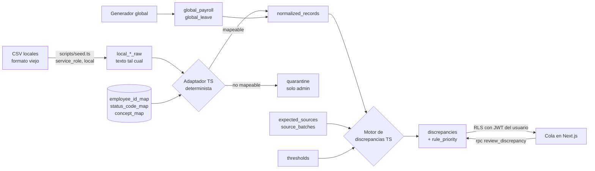

# Fase 1: diseño

## Flujo de datos

## Decisiones

- **Período**: `date` con día 1 (`2026-09-01`). Restricción `check` en cada tabla.
- **Normalización de leave**: un saldo de vacaciones es un `normalized_record` con `concept = 'leave_balance'` y `unit = 'days'`, así payroll y leave comparten el mismo motor.
- **Scope helpers**: funciones `SECURITY DEFINER` en el esquema `private` (no expuesto por la API). Las políticas las llaman como `(select private.visible_country_ids())::uuid[]` para que se evalúen una vez por consulta.
- **Deny by default**: RLS activo en todas las tablas; sin política = sin acceso. Además se revocan los privilegios de tabla a `anon` y de escritura a `authenticated`, también para tablas futuras (`alter default privileges`).
- **Estados**: solo cambian vía `review_discrepancy`. Transiciones: `open` o `escalated` → `approved`, `corrected` o `escalated`. `approved` y `corrected` son finales. `correct` y `escalate` exigen comentario.
- **Auditoría**: `audit_log` es append-only (trigger). `log_event` pone `user_id` y `role` desde el JWT.

## Prioridad por reglas (`rule_priority`)

1 = alta, 2 = media, 3 = baja. Se calcula en TypeScript (`lib/discrepancies/priority.ts`):

| Condición | Prioridad |
|---|---|
| `missing_file` | 1 |
| Varianza ≥ 3× el umbral, o `missing_in_global` de pago | 1 |
| `amount_mismatch` bajo 3× el umbral, o `missing_in_local` | 2 |
| `leave_balance_mismatch` bajo 3× el umbral (no bloquea el pago) | 3 |

`rule_reason` guarda en español la regla que se aplicó.

## Umbral

Una diferencia es discrepancia si `|local − global| > abs_threshold` **o** `|local − global| / |global| > pct_threshold`. Se usa el umbral del país si existe; si no, el default (`country_id` nulo).
